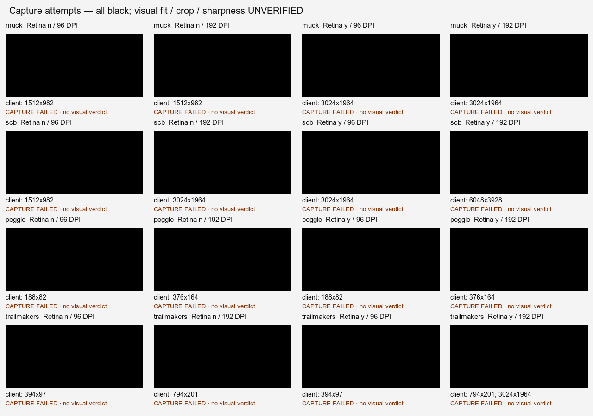

# Standard display defaults

This first change ships Standard defaults only, as agreed during implementation.
The per-game Display picker and Sharp (Retina) option are deferred until the Wine
engine can implement them correctly. No game setting is offered that Wine ignores.

## Lifecycle correction after the investigation

Managed setup now preserves existing prefix display values, with or without a
v1 migration marker. Generic Steam sends do not run a display migration. Only a
prefix newly created by the installer receives off/96 defaults. An interrupted
new-prefix setup retains an explicit initial-provisioning record so a retry can
finish without treating an arbitrary legacy prefix as new.

Normal teardown waits for exit first, then uses a soft `wineserver -k` and confirms
exit if necessary. It no longer hard-kills the server. If exit cannot be proved,
session ownership is retained and the error requires retry. Setup itself only
waits for an existing server; it refuses to kill an orphan/external session to
obtain mutation ownership. New display configuration is cold-read after a
verified stop before `.pufflet-display-verified-v2` is written. Registry readback
confirms saved settings, not game rendering or cached effective display state.

Ready/starting host reuse now checks canonical prefix, library, account, runtime
path plus artifact/launcher content identity, and queried display configuration.
Standalone setup shares the session actor's ownership gate; it cannot configure
a live host or one with submitted/paused work. Managed setup/readiness/sign-out
cleanup use the injected data paths. The display picker and isolated per-game
prefix migration remain future work in [the architecture design](PER_GAME_DISPLAY_ARCHITECTURE.md).

The offline [persistence probe](../scripts/ci/wine-registry-persistence.py) used a
new temporary prefix with the shipped Wine 11.0 (Sikarugir) runtime binaries
read-only, no Steam client/account, and no Dev/production prefix data. It reproduced loss of a
new registry value on immediate `-k9` in **3/3** runs; soft `-k` preserved it in
**3/3** cold-start queries. Natural exit did not settle within three seconds in
**3/3** runs, so its durability result is unknown. These are server/registry
measurements, not authenticated Steam shutdown or game/save/cloud validation.
See the [numeric observations](evidence/display-defaults-20261016/registry-persistence.json).
Recorded durations include restart/readback, and timed-out natural-exit rows also
include the cleanup soft stop. They are not a teardown latency benchmark.

The actual Swift runtime path also has an opt-in temporary-prefix test:

```sh
TEST_RUNNER_PUFFLET_OFFLINE_RUNTIME=/absolute/path/PuffletRuntime.app \
  xcodebuild test -project SteamLibrary.xcodeproj -scheme SteamLibrary \
  -configuration Debug -destination 'platform=macOS' \
  -only-testing:SteamLibraryTests/SteamDisplayDefaultsTests \
  CODE_SIGNING_ALLOWED=NO
```

This does not fix or establish the cause of the reported Over the Hill zoom.
Its visual regression remains open.

## v0.3.0 behavior and migration (historical)

Pufflet's private prefix defaults to Retina off and 96 DPI. Games use the display's
resolution in points, with macOS handling the backing scale. Automatic resolution
is unchanged; games retain their own fullscreen/windowed resolution settings.

Steam client setup no longer imports `RetinaMode=y` or `LogPixels=192`. On the next
private-prefix preparation or desktop-Steam launch, a separate migration imports
only these two values:

```reg
[HKEY_CURRENT_USER\Control Panel\Desktop]
"LogPixels"=dword:00000060
[HKEY_CURRENT_USER\Software\Wine\Mac Driver]
"RetinaMode"="n"
```

The prefix-local `.pufflet-standard-display-v1` marker is written only after a
successful import. Failed imports retry on the next launch. Later launches do not
rewrite display preferences. Other registry values, saves, installed games,
library links, and Steam account/session data are preserved. Desktop fallback does
not migrate an external wrapper's prefix. There are no new session restarts or
changes to Dock/session lifecycle. An already running game keeps its current
display configuration until it exits.

## Why AppDefaults cannot implement Sharp

[Wine 11's Mac driver](https://github.com/wine-mirror/wine/blob/wine-11.0/dlls/winemac.drv/macdrv_main.c#L343-L346)
explicitly passes a null application key when reading `RetinaMode`. The comment
explains that DPI and monitor sizes must stay consistent across processes in a
prefix. [Sikarugir's source](https://github.com/Sikarugir-App/wine/blob/master/dlls/winemac.drv/macdrv_main.c)
retains this exclusion. Its other Mac driver options using AppDefaults do not make
RetinaMode an application setting.

The installed Wine 11.0 runtime was also checked in a separate test prefix:
global Retina off/96 DPI plus an application override requesting Retina still
produced a 1512×982 desktop after a cold start on this Mac. With global Retina on,
the driver desktop was 3024×1964. Thus an AppDefaults-only picker would be
ineffective. No supported per-launch Retina environment override was found.

A working Sharp implementation needs either an engine change with shared-display
compatibility testing, or separate prefixes with a larger Steam/session design.
Changing the shared registry between launches does not provide process isolation
and is unsuitable for a persistent session. Runtime artifacts and signing are
outside this PR. DPI remains 96; modern-game Sharp UI scaling is deferred with
Sharp. The optional virtual-desktop resolution selector is also deferred rather
than adding another launch mechanism in this Standard-only fix.

## Diagnostics

Each private-prefix preparation writes the queried registry configuration to
`wine.log`, using only numeric stage fields:

```text
[steam-host] pufflet1 display-defaults-migrated=1
[steam-host] pufflet1 display-mode=0
[steam-host] pufflet1 display-retina=0
[steam-host] pufflet1 display-dpi=96
[steam-host] pufflet1 display-resolution=0
```

`display-mode`: `0` Standard, `1` Retina, `2` custom DPI, `-1` unknown.
`display-retina`: `0` off, `1` on, `-1` unknown.
`display-dpi`: queried integer DPI, or `-1` if unavailable.
`display-resolution=0`: automatic, no virtual desktop override.
`display-defaults-migrated`: `1` only on the migration call, otherwise `0`.

These fields describe the registry configuration for new launches, not a running
game's chosen resolution or the cached display state of an existing process.
Raw query output, account identifiers, credentials, and filesystem paths are not
included in these lines.

## Validation

- The app builds with the normal Debug identity and signing disabled.
- Migration regression coverage checks once-only execution, save preservation,
  cleanup and retry after failed imports, and privacy-safe numeric diagnostics.
- The actual Swift migration helper was run against the isolated Wine prefix
  seeded with the old settings: first call migrated, second call skipped, and a
  test save was preserved.
- A standalone command-line harness ran the actual `SteamRuntime` registry-query
  and logging code against the same isolated prefix. It logged Standard, Retina
  off, DPI 96 and automatic resolution. A DPI-aware Windows probe independently
  reported DPI 96 and matching 1512×982 screen metrics/display mode.
- Wine display logging was enabled only in the isolated prefix
  (`WINEDEBUG=-all,+display,+macdrv`). The production prefix and Steam data were
  not used for these checks.
- All 66 tests passed with the normal Debug bundle identity while holding the
  shared verification slot. The normal app build passed as well.
- Peggle's offline launch stopped at missing Steam initialization; Trailmakers
  initialized Direct3D 11.1 on the M4 Pro but failed Steam initialization. These
  runs do not establish crop-free rendering or usable game UI. Native Wine-window
  capture also timed out.
- Online game verification was explicitly skipped at the user's request before
  the waiting Keychain read completed. No online QA game session was started.
  Before/after game screenshots, Peggle crop verification and modern-game UI/text
  checks therefore remain unverified. The driver-level findings above are not a
  substitute for that visual evidence.


## Follow-up investigation: DPI and Retina regression (2026-10-16)

**192 DPI demonstrably creates oversized windows in the older Super Crate Box
runner. The new Over the Hill regression is not yet reproduced or root-caused.**
Do not treat the driver-level validation above, or the dimensions below, as proof
that every game renders without cropping.

The user reports that Over the Hill fit before v0.3.0 and looks zoomed after it.
Commit `82f6176` changed two independent variables together: Retina on → off and
192 → 96 DPI. A comparison of only old versus new defaults cannot identify which
change is responsible for a particular game.

### Scope and method

The Dev library contained Muck and an incomplete The Forest download. Portal 2
was absent. At the user's direction, no new games were installed and no Dev Steam
sign-in/session switch was performed. Existing isolated QA copies supplied Super
Crate Box, Peggle Extreme, and Trailmakers. The Forest's partial files were not
used. Production game content and saves were not accessed; only the explicitly
permitted production `user.reg`, Pufflet logs, and process metadata were read.

The shared Dev verification slot was held. Pufflet Dev was not running, and no
Dev dockhost was started. Every cell used the installed `wine-11.0-dxmt-2` Dev
runtime, DXMT environment, and Dev prefix. Before each cell, the Dev wineserver
was stopped with prefix-scoped `-k9` and its exit confirmed with `-w`. The original
Dev user registry was restored, then the two display values were edited while
Wine was stopped. Live `reg query` assertions checked both values for each run.
The prefix was stopped and the original user registry restored after testing.
Production's prefix/server was never stopped or modified.

An initial attempt imported settings and immediately killed Wine before registry
writes were flushed. Live DPI verification caught this; those results were
**discarded**, and the matrix was rerun with offline edits and live assertions.
The final evidence is [display-matrix.json](evidence/display-defaults-20261016/display-matrix.json).
It contains numeric display/window metrics and public game/window names, not
account data, raw registry dumps, or unfiltered logs.

Measurements come from a Windows helper using `SetProcessDPIAware`,
`EnumDisplaySettings`, `GetSystemMetrics`, `GetWindowRect`, `GetClientRect`, and
`GetDpiForWindow`. Dimensions below are the **DPI-aware observer's window/client
coordinates**, not a claim about the game's internal render resolution. A later
helper also queried window DPI awareness and an unaware thread's coordinate view.
A process-level awareness query alone was misleading: Muck's process default was
unaware, but its actual game window was per-monitor aware (`2`). Super Crate Box's
window was unaware (`0`).

### Matrix

| Game / measurement | Retina off, 96 | Retina off, 192 | Retina on, 96 | Retina on, 192 |
| --- | --- | --- | --- | --- |
| Wine desktop (aware probe) | 1512×982 | 1512×982 | 3024×1964 | 3024×1964 |
| Muck client (Steam unavailable) | 1512×982 U | 1512×982 U | 3024×1964 U | 3024×1964 U |
| Super Crate Box client | 1512×982 U | 3024×1964 **O**, U | 3024×1964 U | 6048×3928 **O**, U |
| Peggle Extreme: error dialog only | 188×82 U | 376×164 U | 188×82 U | 376×164 U |
| Trailmakers: error dialog / transient client | 394×97 U | 794×201 U | 394×97 U | 794×201 / 3024×1964 U |

`U` means the requested visual classification (zoomed/cropped, fitting but
blurry, fitting and sharp) **could not be established**. `O` means measured
window oversize relative to the Wine desktop; it is geometric evidence, not a
verified screenshot verdict. Peggle and Trailmakers error-dialog dimensions are
not game resolutions. Their internal render resolutions are unavailable.
Muck's saved resolution is 3024×1964 in every baseline; Super Crate Box's own
reported render resolution was not obtained.

### Screenshot evidence and limits



These are actual Win32 client-capture attempts, **not usable game screenshots**.
GDI `BitBlt` returned black images for the Wine/DXMT windows and dialogs. The Mac
computer-use interface could not bind the unbundled Wine game process by either
name or executable path. No fit/blur/sharpness verdict is inferred from black
captures. The full requested visual matrix remains incomplete.

Muck reached a game window offline, but its log reports `SteamApi_Init returned
false`; this is not normal authenticated gameplay. Super Crate Box reached its
GameMaker main loop. Peggle stopped at `STEAM ERROR`. Trailmakers reported
`Steamworks is not initialized`; its launcher exited while a Steam error dialog
remained. One measurement also caught a transient game client. The matrix
records the windows present at measurement time, not successful gameplay.
No Steam API/DRM bypass, replacement DLL, or entitlement workaround was used.

### Saved game configuration

Muck's original `HKCU\Software\Dani\Muck` contains two resolution sources:
Unity's `Screenmanager Resolution Width/Height` are **3024×1964**, and its
`save_h2088338340` binary value decodes to a PlayerSave XML document containing
`resolution` **3024×1964**, fullscreen `true`, fullscreen mode `1`, and 144 Hz.
Unity's native-resolution flag is `1`. With those same stale high-resolution
values restored before each run, Muck's measured client nevertheless follows
Retina: 1512×982 off, 3024×1964 on. Thus a stale saved size exists, but that alone
does not prove cropping; render-buffer dimensions and the actual image remain
unverified. No game settings or saves were deleted.

The permitted production registry snapshot for
`HKCU\Software\Funselektor\over the hill` contains **1512×982**, fullscreen mode
`1`, and native-resolution flag `0`; the prefix contains Retina `n` and 96 DPI.
The log confirms the Standard-display migration occurred. This snapshot does
**not** show a retained 3024×1964 Unity Screenmanager resolution for Over the Hill.
There is no pre-update snapshot, and the allowed registry evidence does not
establish whether the game has additional settings in files. Do not claim that
its stale configuration is ruled out altogether, or reset its settings based on
Muck's configuration. Over the Hill was not installed in an allowed test library
and was not launched during this investigation.

### Mechanism: independent coordinate and rendering scales

1. **Retina changes Wine's desktop coordinate space.** On this Mac, at either
   DPI, Retina off exposes 1512×982 and Retina on exposes 3024×1964. The vendor
   driver's `create_mode_dict`, `display_get_modes`, and
   `display_get_current_mode` double the original mode's dimensions when Retina
   is enabled. Its Cocoa surfaces/layers separately use Retina backing scale.
   A game using fixed pixel sizes can occupy more of the screen after the
   available pixel grid is halved; a game scaling UI proportionally may fit but
   lose detail. Neither result follows from the number “100%” alone.
   [Vendor display code](https://github.com/Sikarugir-App/wine/blob/master/dlls/winemac.drv/display.c)
   and [Cocoa surfaces](https://github.com/Sikarugir-App/wine/blob/master/dlls/winemac.drv/cocoa_window.m).
2. **DPI affects awareness-dependent coordinates and UI.** Windows normally gives
   unaware apps a 96-DPI coordinate model and scales their output; DPI-aware apps
   can handle scaling themselves. Wine implements its own compatibility path,
   so Windows documentation describes the model, not a guarantee about every
   DXMT title. Here, Super Crate Box creates a window twice the desktop dimensions
   at 192 DPI, while per-monitor-aware Muck keeps its client equal to the desktop.
   Raising DPI is therefore not a general cure for zoomed games. At 96 DPI this
   extra 2× DPI factor disappears in both measured clients.
   [Microsoft DPI-awareness model](https://learn.microsoft.com/en-us/windows/win32/hidpi/high-dpi-desktop-application-development-on-windows)
   and [Wine system-DPI initialization](https://github.com/wine-mirror/wine/blob/wine-11.0/dlls/win32u/sysparams.c#L5435-L5447).
3. **Fullscreen does not necessarily mean a display mode switch.** Unity mode
   `1` is `FullScreenWindow`: it covers the desktop, unlike exclusive fullscreen.
   Muck's actual display mode remained equal to the corresponding Retina desktop
   throughout the matrix. The vendor driver's exclusive mode-change path finds
   a matching mode, requests a macOS display mode, then resets device metrics;
   it does not unconditionally crop a framebuffer whenever Retina is off.
   A mismatched client/render target, stale resolution, failed mode change, or
   compositor/presentation bug can still crop or enlarge output. These runs do
   not demonstrate a real game's successful exclusive mode switch. A separate
   probe found no advertised 1280×720 mode, so did not attempt that switch or
   change the host display. These results do not establish crop-free exclusive
   fullscreen.
   [Unity fullscreen modes](https://docs.unity3d.com/ScriptReference/FullScreenMode.html)
   and [vendor mode-switch implementation](https://github.com/Sikarugir-App/wine/blob/master/dlls/winemac.drv/display.c#L738-L805).
4. **Registry settings are not live-process measurements.** The driver explicitly
   reads Retina without an AppDefaults key to keep monitor sizes consistent
   across the prefix. The Standard migration updates registry values without
   restarting an existing host/session. Mixed cached display state is an
   additional hypothesis for the first post-update launch, not a reproduced root
   cause here. A launch-time registry diagnostic cannot certify a running game's
   cached coordinate space. Test profile switches only after the complete host
   and wineserver have exited.
   [Vendor Retina setting](https://github.com/Sikarugir-App/wine/blob/master/dlls/winemac.drv/macdrv_main.c#L364-L369).

### Recommendation and remaining acceptance gates

Keep **96 DPI** as the provisional baseline. The observed older-game oversized
window is a concrete reason not to restore 192 DPI globally. Retain **Retina off
as the conservative new-prefix compatibility/performance baseline**, with the
explicit caveat that this investigation has not established it as the visually
best default for all games. For existing installations, prefer preserving a
known-working display profile and a reversible switch over another forced
migration. No blanket default reversal or automatic game-config reset is
justified by the incomplete Over the Hill evidence.

A per-game profile is needed for differing compatibility requirements, but it
must be real isolation or a serialized full-session switch. Recommended knobs:

- **Retina / high-resolution backing**, independently from DPI; default 96 DPI
  in either Retina mode. Explain the rendering-cost/sharpness tradeoff.
- **DPI** as an advanced compatibility setting (96 baseline; explicit alternatives
  such as 192), without claiming all games honor it or that it controls render
  resolution.
- **Windowed / borderless / exclusive mode and resolution**, through the game's
  supported settings/launch options. Keep these separate from Wine's DPI. Offer
  a virtual desktop only as a separately implemented compatibility option.
- **Reset display settings** only with a game-specific adapter, backup/restore,
  and a preview of exactly which display values change. Never delete a whole
  Unity PlayerPrefs key: Muck stores gameplay and display data together.

Retina cannot be implemented by an AppDefaults-only picker in this engine.
Separate prefixes require Steam/session, saves, cloud, and dependency validation;
a smaller shared-prefix solution must stop downloads/games/host, await wineserver
exit, apply the selected profile, and restart the selected session. Do not mutate
these settings under the persistent host.

Before choosing a different global Retina default or shipping a fix for Over the
Hill: obtain an authorized Dev copy; compare the same scene/menu across all four
cold-start profiles; record the game's displayed resolution and render target,
client/desktop coordinates, and native screenshots; then compare its original
config with a backed-up display-only reset. Test warm migration versus a complete
cold restart separately. Repeat any crop reproduction in exclusive and borderless
modes. The current evidence explains an older game's DPI oversize, but **the
reported Over the Hill regression remains open**. This documentation-only change
intentionally makes no runtime claim or speculative settings mutation.
