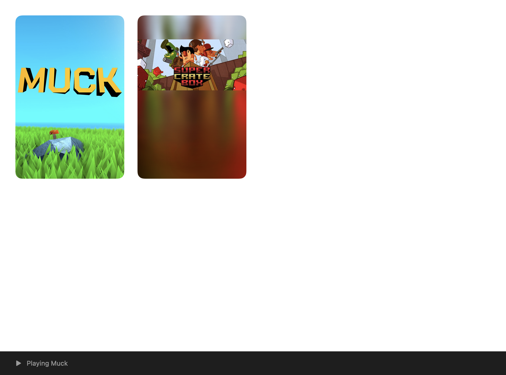

# Persistent Valve client session

## Design (before implementation, 2026-10-16)

Pufflet will own one long-lived `dockhost.exe --serve` process in its private
Wine prefix. Valve's original, hash-pinned January client authenticates once,
checks every requested game's licence, schedules installations and launches
games. Pufflet does not download depots, fabricate manifests, bypass DRM or
open a second online client. Desktop Steam remains incompatible with this
session and must be closed first.

The existing `--install <appid>` and one-shot launch paths remain available.
`PUFFLET_PERSISTENT_SESSION=0` selects those paths and their existing UI gates;
`MADEIRA_DOCK_SERVE=0` independently refuses daemon startup. An ABI/auth failure
never silently falls back to another launch or credential source.

### Transport and authorization

Use inherited stdin for bounded ASCII command lines and stdout for numeric
`[steam-host] pufflet2` events. Wine must demonstrate inherited pipe support
before this transport is considered verified. A dedicated reader may block on
stdin, but it only parses/enqueues commands; all Valve calls and callback
dispatch happen on the pump thread. EOF requests shutdown. Reject oversized,
malformed, unknown, duplicate or nonmonotonic request IDs without echoing input.

Commands are `<requestID> install <appid>`, `pause`, `resume`, `cancel` with
the same arguments, `<requestID> launch <appid> <optionIndex>`, and
`<requestID> status` / `shutdown`. IDs and option keys are decimal integers
bounded to INT32_MAX; request and App IDs are positive. Launch options retain
the original Steam config key, including sparse/nonzero keys. Uninstall is
deferred. Cancellation stops scheduled work and preserves partial files; it
must not uninstall/delete content. Pause/resume/cancel require independently
verified January client methods, never guessed slots.

Every event carries `request-id` and `app-id` (zero for session events), plus
allowlisted numeric fields. Request acceptance and operation completion are
separate events. Progress is reported per app in aggregate work KiB using the
already verified 244-byte GetUpdateInfo record; completion still requires both
the API and Valve's matching ACF to say state exactly 4. Swift bounds/fragments
the stream, validates the complete event and never forwards arbitrary client
stdout, strings, account data or paths to application logs.

The install library is fixed at session start, passed privately through the
existing environment and validated/round-tripped through Valve's library API.
Launches need a fresh expected-folder check, including games installed since
startup. A protected, atomic, bounded per-request sidecar supplies the expected
folder and CEG flag. Its location is derived from the numeric request ID under
the startup-supplied private request directory; no path is sent on stdin or
reported. The host consumes it with no sharing, rejects reparse points and
matches its app/option IDs to the command. No sidecar grants ownership: the
client's current subscription list and LaunchApp must independently allow it.

### Host concurrency

`session.c` retains its token consumption, exact client/method checks and
online sign-in. Serve mode enters a single callback pump after sign-in rather
than immediately running one blocking install or launch. Clear the one-use
token immediately after SetLoginToken, as today; clear the rest of the transfer
before entering the long-lived pump. No offline daemon/cached-login fallback.

Install jobs are bounded records. Submit each accepted InstallApp to Valve and
poll each job independently once a second; Valve owns queue priority and shared
dependencies. A queued/paused job must not trip the old two-minute no-progress
timeout. Session loss is fatal and leaves Valve's partial files intact.

One active launch becomes a pollable state machine: entitlement, expected
install folder, CEG preparation, discovery registry publication, LaunchApp,
strict callback 1270027/524-byte/GameID/error decoding, bounded update/config/
other-session retries, running and three-second exit debounce, then discovery
restoration. Dispatch CEG and launch callbacks before freeing them. No nested
callback pump or sleep-until-game-exit loop may starve downloads or commands.
Service preparation must happen before the shared pump or otherwise avoid
blocking it. Keep one-shot behavior unchanged, sharing validation helpers where
practical. Only the pump thread calls Valve interfaces.

Valve controls its download-while-playing policy. Report a pause only from a
verified client pause state, not from an absence of progress. If same-session
launch demonstrably prevents downloads, stop and report the evidence before
adding any fallback. A possible later fallback pauses and auto-resumes inside
the same session, subject to the user's direction.

### Swift ownership and lifecycle

Add a `SteamSessionHost` actor owning the child, stdin writer, bounded stdout
decoder, request IDs, operation state, startup/shutdown and event stream. A
main-actor observable facade updates the library/download UI. Coalesce startup
so simultaneous Play/Install requests cannot create two hosts. Prepare client
files/library aliases only before startup; never rewrite libraryfolders.vdf or
the prefix registry underneath a running client. New launches derive their
expected alias from the fixed connected library and verified installed game.

Suspend the native catalogue CM connection before token handoff and keep it
suspended while the host owns the account. Browsing/search/local refresh and
Settings remain usable. Account replacement/sign-out, desktop Steam, changing
the library folder and replacing the Wine runtime require the session to stop;
ordinary Play/Install requests do not. Permit one game at a time while accepting
additional downloads. Track per-game progress/completion/failure independently.

Start lazily on first Play/Install. Keep the session alive while any install
(including paused work) or game is active. Shut down after five idle minutes;
status queries alone do not prolong idle life. On normal quit send `shutdown`,
wait a bounded interval, then use the existing prefix-scoped wineserver fallback
and exact-child termination if necessary. Never kill by process name or touch
another prefix. Preserve partial downloads and the account-scoped queue on quit;
after relaunch, resubmit pending jobs and let Valve check/resume them.

Unexpected host exit fails all in-flight requests with a clear message. Clear
process ownership only once teardown is confirmed; the next user action may
start a fresh session/token. Do not automatically replay a launch or uncertain
write after a crash. Explicit pending download recovery is idempotent through
Valve's install path. Startup and shutdown are cancellation-safe and stale
reader/termination callbacks cannot mutate a newer session.

### Implementation and evidence boundaries

1. Commit this design before implementation.
2. Implement Dock serve mode and pure decision/parser tests with assertions,
   sanitizer checks, cross-builds and privacy checks. Preserve the exact DLL
   hash/method gates; document any new ABI evidence in CLIENT_LAYOUTS.md.
3. Publish the fork's `pufflet` branch, update the submodule and fork notice,
   and rebuild only Pufflet's explicitly requested bundled dockhost.exe.
4. Implement Swift routing and UI with focused protocol/lifecycle/queue tests.
5. Use a newly isolated test support directory, prefix and library for live
   tests. Never read/copy the user's Steam login cache, manifests or game files.
   An authorized native one-use token is the only account handoff.
6. Test download plus installed-game launch, two queued installs, quit/resume,
   host crash/recovery, idle shutdown and both kill switches. Capture real UI
   evidence when available. Run native tests, app build and existing CI checks.
7. Open a PR against `talhabalaj/pufflet:main`, with measured results and gaps.

No releases, runtime ZIP/tar artifacts, runtime pins, signing configuration or
Xcode Cloud release configuration are part of this change. Risks remain the
undocumented client ABI and exact client pin, Wine staying alive during work,
one online account session, untested games/DRM and abrupt discovery cleanup.
Local tests/builds do not establish Valve concurrency behavior or E2E success.

## Added requirement: missing game files

The user requested recovery when game files are deleted. Library discovery
must not call an absent game folder installed. A valid launch entry whose
executable is missing offers Repair installation. Reinstall/repair of an
API-state-4 app asks the pinned client's verified StartValidatingApp method to
check and restore content; only a subsequent observed update transition plus
API/ACF completion succeeds. No local manifest/DRM modification is introduced.

## Results

The design was committed as `1b1b0cd` before implementation. Dock's `pufflet`
branch is published at `3c14dcc3d206fec11fa42d250b4a492fb25cad2a`; the submodule,
rebuild script and notices name that exact corresponding source. The bundled
host was rebuilt with LLVM/MinGW 20260421. No Wine/DXMT runtime artifact/pin,
release, signing configuration or Xcode Cloud release configuration changed.
Local builds/tests used the existing Apple Development signing identity.

### Isolated Mac/Wine evidence

All live client/game operations below targeted a new temporary prefix/library.
The saved sign-in was used only for one-use host handoffs; no existing Steam
prefix, game installation or credential cache was copied into the test. The
inherited XCTest host could initialize its normal library model before test
fixtures ran; its initial model is now also isolated to temporary test data.
No test logs, tokens, account identifiers, client DLLs or game files are shipped.

- Valve installed Muck (1625450) with state 4 and
  104,901,520/104,901,520 downloaded bytes. The same host accepted Super Crate Box
  (212800) and launched Muck: matching GameID, callback 1270027, 524 bytes,
  client error 0 and game-running event/process. Its D3D11 device initialized.
- Valve's content state showed the second update suspended while the game ran.
  After ending only the exact isolated Muck process, the same client completed
  Super Crate Box: state 4, UpdateResult 0 and
  21,048,992/21,048,992 downloaded bytes. No policy override or app-managed
  pause-before-Play workaround was added. This demonstrates Valve-managed pause
  and resume; it does not prove downloads continued during gameplay.
- Pause and Resume returned success and updated the per-game state.
- A clean session shutdown during a partial repair, followed by another start,
  retained/resumed Valve's partial content.
- SIGKILL of the exact host produced a clear error; the next action tore down
  its prefix, obtained a fresh one-use handoff and completed the repair.
- Two install requests were accepted into the same session and both completed.
- Moving only the temporary Muck folder aside made discovery exclude it despite
  the old state-4 ACF. Valve's StartValidatingApp restored the missing folder;
  the backup was retained. Fast verification transitions are sampled separately
  from the one-second progress cadence.
- Five minutes without a tracked install/game caused normal idle shutdown.
- `PUFFLET_PERSISTENT_SESSION=0`'s one-shot install path completed successfully.
  Its Play/download exclusion also has model-level coverage. One-shot launch
  code remains unchanged; it was cross-built, not separately played live here.

Whole-application quit and relaunch, beyond session-owner restart, is being
checked separately before finalizing this evidence.

These are captures of the actual isolated Pufflet view, including the client's
running state. They do not show or prove visible gameplay/rendering. A separate
read-only BIsDownloadingEnabled query handles policy suspension without per-app
paused bit 512; its slot/name/IPC and pause classification have focused checks.

### Automated validation

- 73 native Swift tests passed with Apple Development signing; the ordinary
  suite skips real-account tests. Coverage includes fragmented/bounded numeric
  streams, wrong-app responses, coalesced startup, launch during a pending
  install, crash/restart, clean shutdown preserving pending jobs, ownership
  retained after teardown failure, deleted folders/executables, persistent
  queue restoration and the serial fallback.
- All four Dock ASan/UBSan suites passed, including protocol, idle/pause and
  exact-adapter/method rejection assertions. x64 and i386 cross-builds passed
  with warnings treated as errors.
- Independent checks of the pinned official DLL passed for the added queue,
  verification and downloading-enabled slots, own-method names and IPC IDs,
  paused-state instructions and uninstall negative control.
- 37 existing Node tooling tests, five Python tooling tests and the site's
  tests/typecheck/build passed. Local Node 22.17 requires
  `NODE_OPTIONS=--experimental-strip-types` for the existing Cloudflare scripts;
  its compiler also needs a local listening socket. Shell syntax checks passed.
- Dock's working-tree privacy scan/self-test passed. Its all-history scan still
  reports 14 inherited upstream path/email findings; no history was rewritten.

### Reproduction and remaining limits

Acquire the shared Dev/account slot before launching the test host or using a
real online sign-in: `$HOME/personal/pufflet-dev-slot acquire persistent-session`.
Keep it only while needed; quit the test app and stop its prefix before release.
Never run a second account session from another thread. Follow WAIT/renew/release
instructions from the slot command.

The opt-in `PersistentSessionLiveTests` require a root under a
`/private/tmp/pufflet-live-session-*` (or canonical `/tmp/` equivalent), an
installed runtime executed read-only, and explicit real-account authorization.
`PUFFLET_LIVE_SESSION=1` selects install/launch; `PUFFLET_LIVE_RECOVERY=1` selects
repair, queue controls, crash, idle and one-shot install. Pass the root/runtime
as `PUFFLET_LIVE_ROOT` / `PUFFLET_LIVE_RUNTIME`; Xcode's command-line runner
forwards variables with the `TEST_RUNNER_` prefix. They are disabled in CI.
The recovery check reversibly moves only the freshly downloaded test game aside.
Do not point these tests at an existing user library.

Remaining risks: undocumented client ABI and exact January pin; one online
account session; Wine kept alive while jobs run; abrupt discovery cleanup;
client update/error fields not comprehensively decoded; CEG/service behavior,
paid games, network/disk failures, cloud saves, overlay and extended rendering
not covered by these live runs. A refused or unobservable verification fails
closed instead of declaring a stale manifest repaired. Cached owned titles
remain available while the native CM catalogue stays disconnected from Dock.
The branch is not a signed/notarized public release or a runtime publication.
