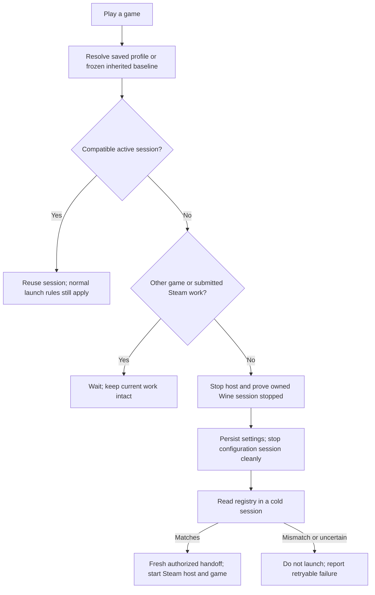
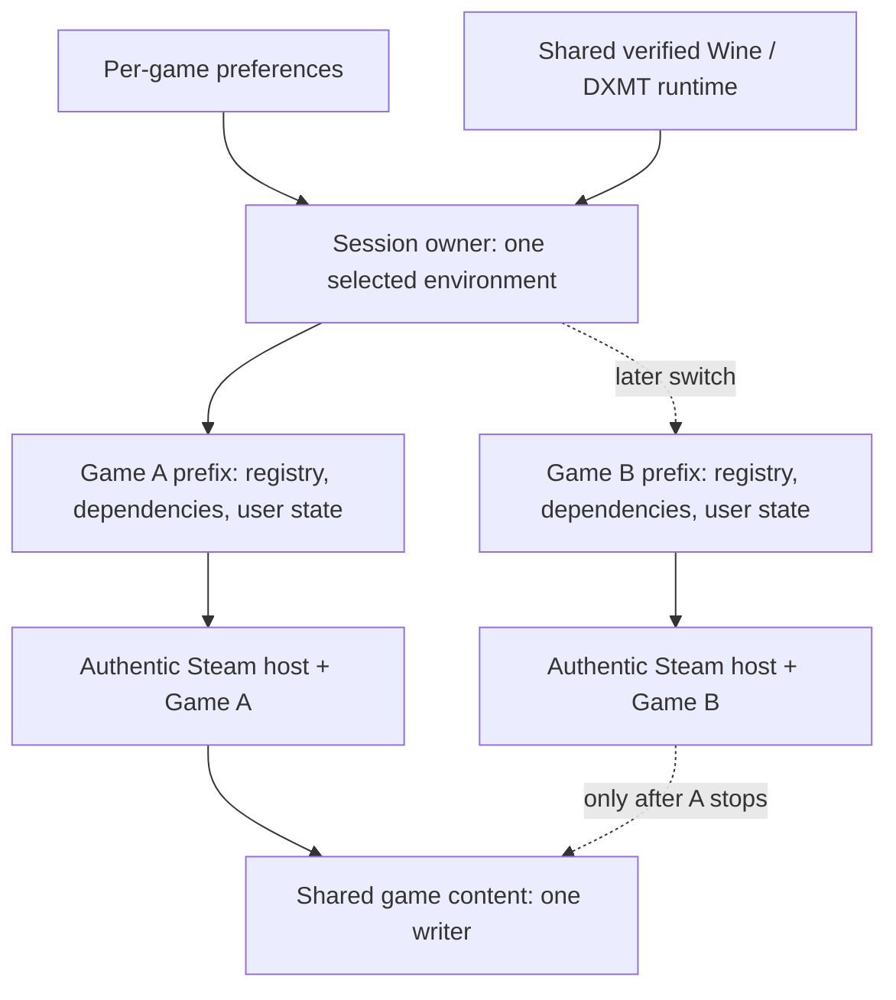

# Per-game display and Wine session architecture

Status: approved design, under staged implementation. Reviewed with Opus 5.5 in
two rounds. The lifecycle and shared-prefix display-profile layers implement the
first steps; authenticated real-game acceptance and prefix isolation remain open.

Tracking: [Proton comparison and acceptance gates, issue #12](https://github.com/talhabalaj/pufflet/issues/12).
Evidence: [display investigation](DISPLAY_DEFAULTS.md).
Interactive explanation: [display architecture](display-architecture.html).

## Decision

Save display preferences per game. Initially apply them to the existing shared
Wine prefix only after a complete, safe Steam/Wine stop. In parallel, prove
isolated per-game prefixes before offering migration. The first release is a
compatibility feature; it does not finish the isolation work in issue #12.

A prefix is a game's Windows environment: registry, Windows files, dependencies,
and user files including saves. It is separate from the Wine/DXMT runtime and
the installed game content. Retina and DPI belong to this environment, so two
conflicting profiles cannot safely run in its same Wine session.

Over the Hill's reported zoom regression is still unconfirmed. This architecture
enables controlled configuration and isolation; it is not evidence of a crop fix.
The earlier native Muck screenshot in issue #12 and this branch's failed black
captures are separate experiments.

## First release: per-game settings, one shared environment

Two examples: Game A requests Standard (Retina off, 96 DPI); Game B requests
High resolution (Retina on, 96 DPI). Playing A then B changes the shared
environment only between stopped sessions. A's and B's saves stay where they are.
The cost is a Steam session restart when profiles differ. If profiles match,
normal session reuse remains possible.

The runtime and installed game files are shared in both the first release and
the eventual isolated-prefix design. There is no second online Steam host left
running to keep downloads going during a switch.

## Preferences and inheritance

- Initially expose Inherit, Standard (off/96), and High resolution (on/96).
  192 DPI stays behind an advanced compatibility option and is not a recommended
  preset. Retina and DPI remain separate fields internally.
- Store no per-game override until the user selects one. Store choices by stable
  app ID in the current managed-prefix domain; account-owned prefix routing is
  introduced with isolation. Display preferences themselves are not credentials.
- Capture the existing prefix's observed display values once, before the first
  managed profile switch. Persist this inherited baseline atomically. Inherit
  refers to this frozen baseline, never another game's most recently applied
  override. A baseline change must be explicit and describe its effect.
- Preserve unusual legacy values rather than silently coercing them into a
  supported preset; choosing a supported explicit profile is a separate action.
- Marker absence alone does not identify a fresh prefix. Existing Windows,
  registry or game state identifies a legacy environment even without a marker.
  Only a newly provisioned, empty environment receives provisional off/96 defaults.
- Treat the old v1 marker as evidence of a migration attempt, not proof of stored
  intent or durability. Do not reapply off/96 to a legacy prefix to repair it.
- Desired settings and the running session's immutable configuration are distinct.
  Selecting a preference never relabels an existing session. Persisted registry
  readback means settings saved; it does not certify effective rendering.

Game resolution, fullscreen mode, render scale and UI scale remain the game's own
settings. Changing Retina can make previously saved resolutions inappropriate.
Recommend selecting the game's matching resolution when needed. No generic
automatic reset: a future display-only adapter must back up exactly the affected
values and preserve saves and other preferences.

## Ownership and lifecycle

Use the existing session owner, with one in-flight lifecycle operation, before
introducing another coordinator actor. `SteamSessionHost` is an actor;
`SteamRuntime` is a value type supplying operations, not an actor. Main-actor
isolation alone does not prevent interleaving at suspension points.

The managed lifecycle is the only route to prefix mutation or host startup.
Play, install/repair, setup, idle shutdown, account/library changes, runtime
maintenance and desktop launch must obey its gate. Remove or route the automatic
display migration in `SteamRuntime.send` through this owner; replace managed-path
uses of static `SteamHeadlessPaths` with the same injected path source.

An active session's identity includes account, canonical library, canonical
owned prefix, verified runtime artifact, and active display configuration. A
ready or starting host must validate the requested identity, including after
awaiting startup. A runtime path alone cannot identify its artifact version.
Installation work may reuse the current compatible session without applying a
pending game preference. A game requiring another profile must wait or switch,
never silently launch under the old profile.

Every suspended mutation/start step rechecks generation, identity, ownership and
the stopped-session requirement. Late events cannot complete another generation's
operation. All async entry points enforce this; disabling UI is insufficient.
Retain the app's OS-level instance lock. Runtime paths, executable names and
process snapshots are not locks or reliable prefix ownership evidence. Teardown
uses exact owned process/session handles and the selected prefix; never kill by
process name. External Steam/account conflicts are detected and reported rather
than claiming the app lock controls third-party clients. Dev testing still needs
the repository's shared slot.

Profile switching refuses to proceed while another game or any submitted,
active, paused, updating or repairing Valve job exists. A pause acknowledgement
does not establish content quiescence. Queue-only intents may wait, with their
user-paused state preserved. A failed durable queue/settings write blocks a
transition. Do not kill a game or cancel a download to apply display settings.
Desktop/external-wrapper fallback cannot silently accept a managed game override:
report that it is unsupported there and leave the wrapper's prefix unchanged.

## Registry durability is the first implementation gate

Current teardown uses `wineserver -k9` before waiting, and the migration writes a
completion marker immediately after `reg.exe` exits. The investigation observed
an imported change disappear during a forced-stop test. The exact persistence
behavior of graceful wait, soft termination and forced termination still needs
controlled measurement on the shipped runtime.

In a disposable prefix, compare import followed by immediate hard kill, verified
soft stop, and bounded wait after graceful exit. Query after cold restart. Include
an explicit flush and a crash between import, flush, readback and record creation.
Do not assume a signal saves state until the tests show it.

The intended sequence is host shutdown, bounded graceful server wait, a verified
soft-stop path if needed, then hard kill only as emergency recovery. Hard kill
means uncertain state, not a successful configuration transition. Never proceed
until the old owned server's exit is established.

Configuration writes must persist before host/game display initialization. A
temporary configuration Wine session may be necessary: write, flush, stop it in
a verified way, confirm exit, then cold-read the persisted values before starting
the authentic host. Record a new versioned verification only after this succeeds.
Any startup processes created by verification must see the final configuration;
otherwise end that verification session before starting the host.

Reconciliation is idempotent: after a crash, compare explicit desired values with
cold observed values and repeat if required. Do not add a multi-stage migration
journal just for two display keys. Reverting a desired profile uses the same safe
path. Verification failure leaves the game unlaunched and the error visible;
it does not select alternate credentials or silently change profiles.

## Target architecture: isolated environments, shared content

Only one of the two example host/game groups is active. A selected prefix keeps
its persistent session until work ends or a permitted switch occurs. Run the
authentic pinned Windows Valve host and the game in the same prefix; do not
assume Proton's Linux `lsteamclient` bridge exists on macOS or that an existing
host can serve a different Wine prefix. Retain entitlement and normal LaunchApp
checks. Do not bypass DRM or fabricate installation state.

Introduce an immutable WineContext when the two-prefix prototype exists: stable
context ID, owned prefix, account association, runtime identity, and private
handoff/request/report paths. The same ownership rules then select contexts.
Separate mutable registries, Windows state, dependencies and user profiles;
share verified runtime binaries and serialized game content only. Account
switching must not expose a previous account's context or one-use handoff.

The prototype must prove two different cold display configurations, legitimate
Steam API initialization, launch callbacks, exit/relaunch, content recognition
without redownload, launcher-to-game transitions, dependency setup and return
to the previous prefix. Use Muck and an owned DRM/CEG title in disposable roots.
Whether machine identity affects Steam trust or CEG personalization, and how
headless cloud conflicts can be resolved, are open questions. Block unsupported
migration rather than assume these work.

## Migration and rollback after the prototype

Existing games remain on the original prefix until explicit opt-in. Create new
contexts lazily. Each supported game's migration manifest identifies actual save
files, registry keys, display settings and dependencies. Back up, copy, validate,
then switch routing atomically with a migration journal. Preserve unknown layouts
in the legacy environment. Never symlink complete registry hives or user profiles.
Cloud sync is not a backup; test upload, download, conflicts and unsynced state.

Returning to the original prefix after gameplay must reconcile newer saves from
the isolated context; it cannot simply route to old legacy copies. An unresolved
save/cloud conflict blocks automatic rollback and requires a recoverable choice.
Disabling the feature never deletes prefixes or silently rewinds saves.

Serialize manifests, repairs, updates and CEG mutations in shared content. Keep
downloads on the existing installation context and block conflicting switches
until cross-context partial-install resume is proven. Durable download transfer
is a later gate, not a hidden requirement of the first display picker. Every
permitted context switch confirms the old host/server stopped and obtains a fresh
authorized one-use handoff for the target.

## Delivery and acceptance

1. Design checkpoint: commit this agreed design before architecture code changes.
2. Lifecycle PR: isolated persistence tests, safe shutdown, path/entry-point
   ownership, full host identity, async generation checks and work gates. No UI.
3. Display-profile PR: per-game inheritance/overrides, saved-setting verification,
   safe stopped-session switching and explicit fallback limitations.
4. After lifecycle correctness, the two-prefix prototype can proceed independently
   of the display UI. Measure startup/switch latency and physical storage.
5. Only after the prototype passes: opt-in isolated contexts, per-title migration
   and rollback; then separately prove download queue transfer. Feature-flag these.

Tests must cover each failure boundary, cancellation/reentrancy, duplicate Play,
late events, background download submission, runtime/account/library changes,
failed persistence, surviving server, app quit/relaunch, and current legacy-marker
combinations. Use isolated temporary data until authorized live testing. Never
change app identity for a private test copy or access production data implicitly.

Real-game acceptance requires usable native screenshots and the game's reported
resolution, render target where observable, client/desktop sizes, and DPI
awareness. Test Retina off/on × 96/192, original versus display-only reset
configuration, borderless and actual exclusive mode changes. Registry values or
client size alone cannot establish fit, crop, sharpness, or a zoom fix. Finish all
Steam/saves/cloud/download gates in issue #12 before claiming isolated-prefix
support is ready for general use.
