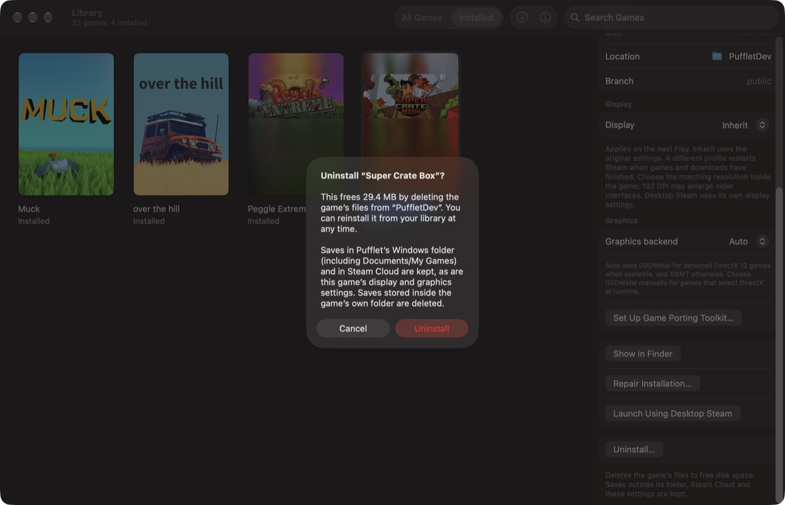
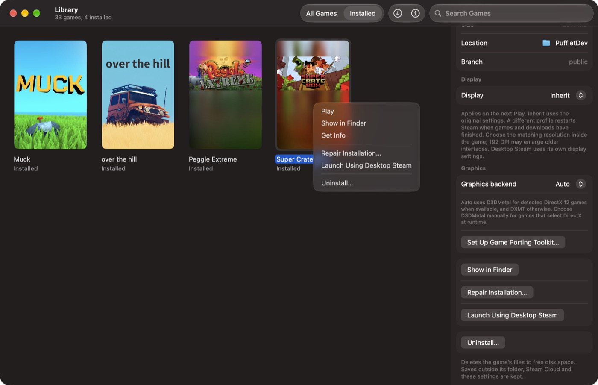
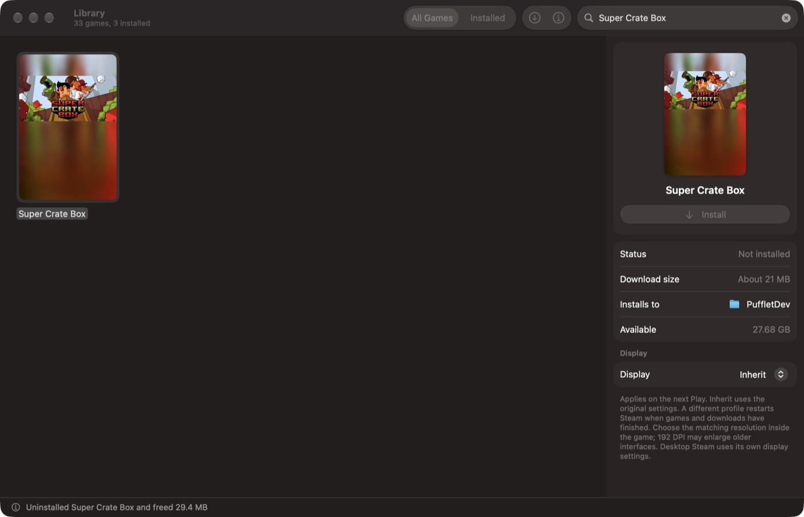
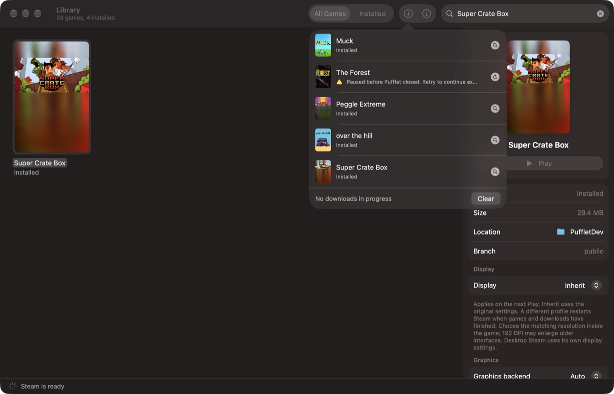

# Uninstalling games

Pufflet's **Uninstall…** action appears in a game's context menu, in the Game
menu and in Get Info. It removes an installed game so it returns to the
owned-but-not-installed state, ready to reinstall.

## Approach: file-level removal with Valve's client stopped

Valve's client does not keep a separate install database on disk. On its next
start it rebuilds each library from the `steamapps/appmanifest_<appid>.acf`
files. `SteamGameUninstaller` therefore removes, in this order:

1. `steamapps/common/<installdir>`
2. `steamapps/appmanifest_<appid>.acf`
3. leftovers, if present: `steamapps/downloading/<appid>`, `steamapps/temp/<appid>`,
   `steamapps/shadercache/<appid>`
4. `<appid>` from the `apps` list of *this* library's entry in the managed
   client's `steamapps/libraryfolders.vdf` and `config/libraryfolders.vdf`.
   `SteamClientInstaller.connectLibraries` merges these lists and never prunes
   them.

Valve's per-library `libraryfolder.vdf` file and other libraries' entries are
left alone.

**Ownership.** The removal runs inside `SteamSessionHost.withClientStopped`. It
is refused while the host has any pending command, install (including a paused
one) or running game. If the host is idle, it is shut down first, so Valve's
client never holds stale install state. Starts, Play, setup and recovery are
refused until the removal returns. The model applies the same rules up front
so it can give a specific reason, such as "Quit Muck…", "…is queued in
Downloads…" or "Quit desktop Steam…". It checks again when the user confirms,
because the state can change while the dialog is open.

**Path safety.** Every path is built from the configured library root, with
symlinks resolved once, and checked with `lstat`:
- `steamapps`, `steamapps/common`, the game folder, the manifest and each leftover
  must be real directories or files, never symlinks;
- `installdir` must be non-empty and must not be `.`, `..`, or contain `/`, `\`,
  NUL or a newline;
- the manifest on disk must name the same `appid` and `installdir`;
- the game must live in the configured library. Games in other libraries are
  referred to desktop Steam.

Symlinks inside the game folder are removed as links, never followed.

**Partial failures.** The game folder is deleted first. If that fails part-way
(for example, permission denied), the manifest is kept, so the game still reads
as installed and the error alert offers **Repair Installation**. If only the
manifest can't be deleted, the files are already gone and Reinstall lets Steam
repair it. Leftover and `libraryfolders.vdf` failures are reported as warnings.

## What stays

- Saves in the Wine prefix (including `Documents/My Games`) and Steam Cloud.
  Saves a game writes inside its own install folder are deleted, and the
  confirmation says so.
- Artwork cache, per-game display profile and graphics backend, so a reinstall
  keeps them.

## Why not Valve's `UninstallApp`

The pinned January `steamclient64.dll` (build 202601) has
`IClientAppManager::UninstallApp` at vtable slot 1, wrapper RVA `0x85c740`. This
was confirmed read-only with the RTTI and method-name approach from
`tools/check-client-layout.py`. Calling it from the persistent host would need:

- a new verified slot in the `madeira-dock` fork's client layout;
- a disassembly review of its arguments and completion signal, since it is
  asynchronous;
- a `dockhost.exe` rebuild with the llvm-mingw toolchain;
- an online, signed-in session for every uninstall.

That is a reasonable follow-up. The file-level removal gives the same result on
disk and works offline.

## Evidence (Pufflet Dev, 2026-10-19)

Super Crate Box (app 212800) was uninstalled and reinstalled in the dev library:

- Before: `common/supercratebox` was 28,728 KB, and the manifest and
  `shadercache/212800` were present.
- After: the folder, manifest and shader cache were gone, `212800` was removed
  from both `libraryfolders.vdf` files, and the other manifests were unchanged.
  Pufflet reported "Uninstalled Super Crate Box and freed 29.4 MB" in under a
  second.
- Reinstall: the manifest was restored and the folder was 28,728 KB again.

| | |
|---|---|
|  |  |
|  |  |
