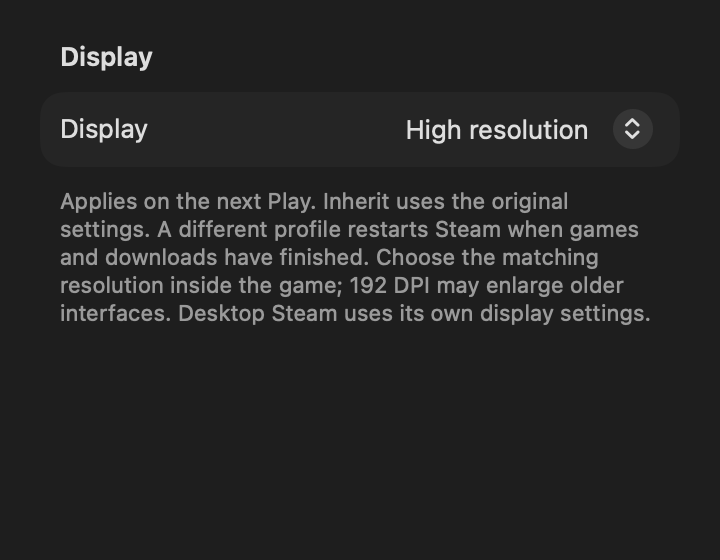
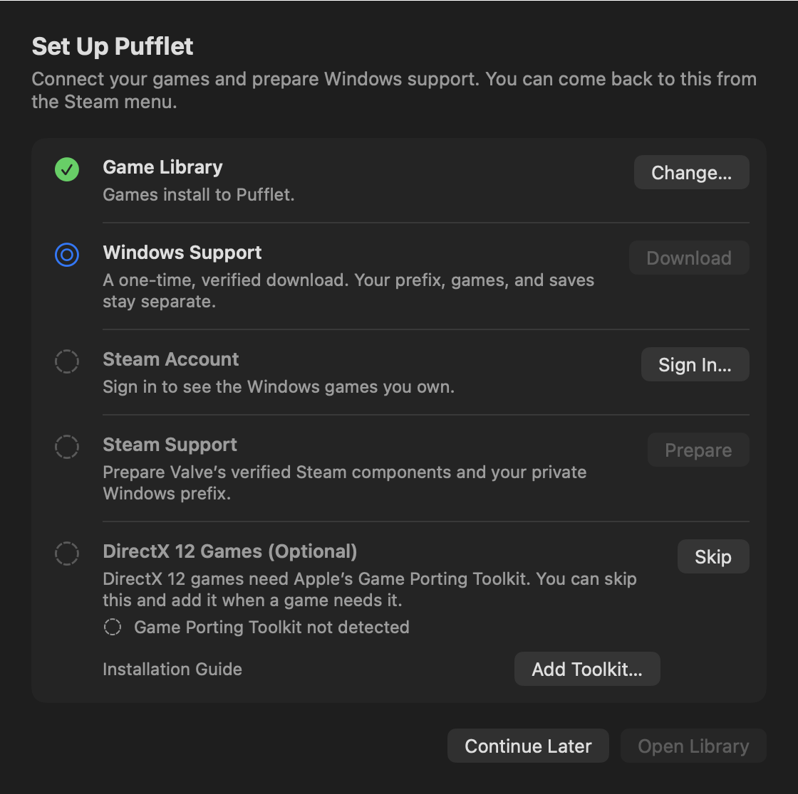
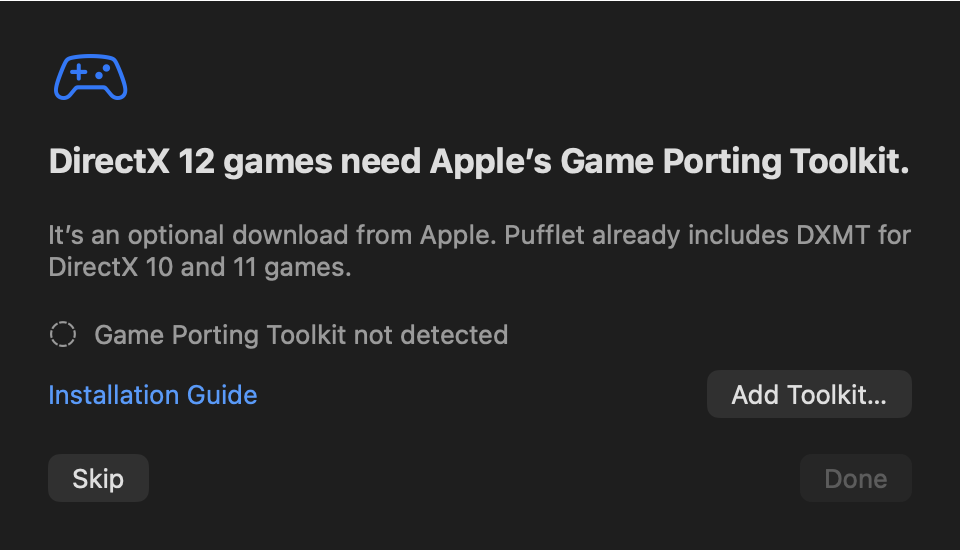
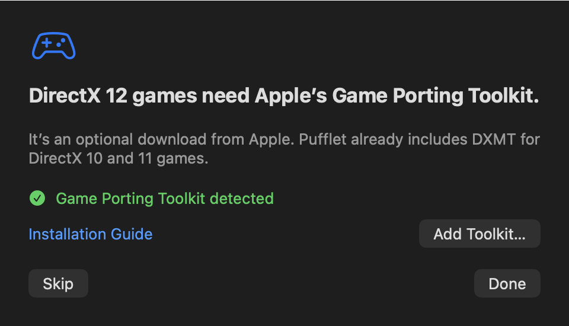
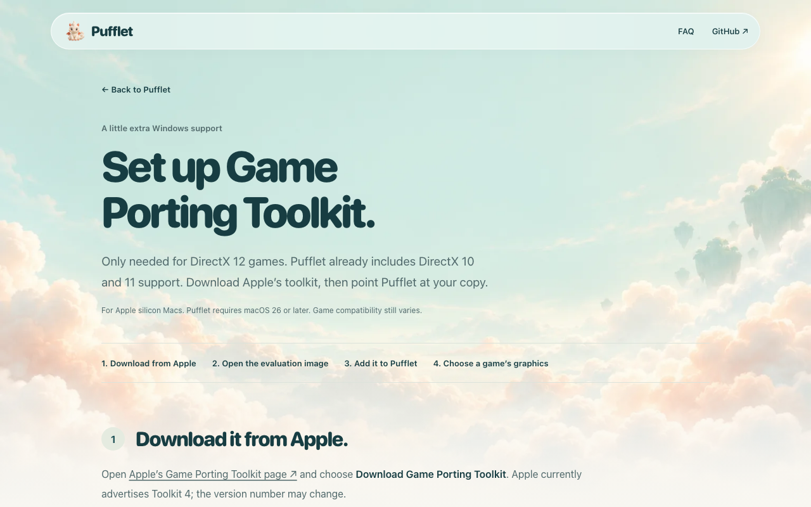
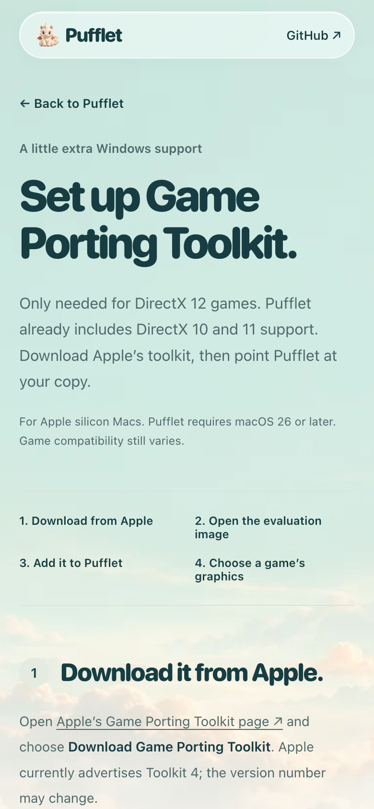

# Combined #14–20 acceptance, 2026-10-16

Tested production/test code: `28431b5`, based on main `65fed9b` after #20 merged.
The subsequent evidence commit changes documentation/screenshots only. #19 was
rebased with gh-stack; published #15/#16 history and other branches were not
rewritten. No PR was merged by this verification.

## Results by feature

| PR | Scope and result | Boundary |
| --- | --- | --- |
| #14 | Release propagation/retry: all 11 publish-release cases pass within the 39-test tooling suite, including delayed success and timeout failure. | Fixture-driven; no release publication/deployment performed. |
| #15 | Committed display investigation and architecture retained and reviewed as the design baseline. | Documentation, not a verified Over the Hill fix. |
| #16 | Both real Wine new/legacy cold-read cases pass in 64.208s. New prefix: off/96 with v2 marker. Existing on/192 plus old marker: stays on/192 without v2 marker. Synthetic save sentinel preserved in both. | No authenticated Steam or real save/cloud claim. |
| #17 | No issue/PR #17 was found in the repository audit. | No feature identified to test. |
| #18 | Real D3D12 sample passes in 20.520s: Apple PE identity/framework, swapchain GPU fence and pixel readback. Onboarding/toolkit missing/detected native captures pass. Guide inspected at 1280 and 390 CSS pixels; no horizontal overflow, all four instruction images loaded. | Original offline sample, not a DX12 game. Native detection capture uses an isolated layout fixture; the GPU check uses the real existing Apple toolkit. No Apple login performed. |
| #19 | 122-test / 22-suite Swift run passes in 37.049s. Seven raw real-Wine transitions and frozen custom Inherit restoration pass. Native Display capture inspected. | Stored settings/lifecycle and component rendering; real-game crop/sharpness remains open. |
| #20 | 22 native Dock policy probes pass. Unchanged real Wine fixture passes both native Quit and ordinary exit in 40.533s. Game regular; sibling/crash helper background; Windows Quit handshake, crash-child reap, companion/sibling survival, final clients zero and allow-record clear all asserted. | Literal Dock menu/true before-after pair remains unverified. |

The full Swift run keeps opt-in live/account tests disabled; the separate live
checks above and below enable only the named offline fixtures. Tooling and site
suites were also rerun on the final source: **39/39** and **7/7**, respectively.
Normal Debug app + XCTest bundle build succeeds with signing. Strict/deep app
and strict bridge verification pass. Bundle ID remains
`me.balaj.SteamLibrary.dev`; product name remains `Pufflet Dev`.

## Integration corrections

The exact selected executable now travels from launch selection through the
profile-switch ownership gate to #20's Dock allow record. A regression changes
both Retina profile and graphics backend in one launch, verifying setup/registry
queries stay on DXMT and shutdown clears the selected-executable record. Existing
renderer-only busy errors are preserved; active/paused-work and wrong-account
regressions still pass. Frozen Inherit, custom/absent values, pending download
intent, cancellation/generation checks and the single session owner remain.
The D3D12 fixture now uses the production bounded graceful/soft teardown rather
than an unbounded manual wait.

The standalone profile verifier now links the exact built production library;
the old source-list compile command could not include #20's new dependencies.
Build it with `sh scripts/ci/build-display-profile-check.sh BUILD_PRODUCTS_DIR OUTPUT`
after a Debug build, then supply the installed runtime and app-owned bridge paths.

## Real Wine profile matrix

Every row uses production import/soft-stop/cold-query/verification-session-stop.

| Raw transition | RetinaMode | LogPixels | Cold query |
| --- | --- | --- | --- |
| 1 | `y` | 96 | Match |
| 2 | `n` | 96 | Match |
| 3 | `y` | 192 | Match |
| 4 | `n` | 192 | Match |
| 5 | `  custom value  ` (spaces retained) | 144 | Match |
| 6 | Absent | Absent | Match |
| 7 | `n` | 96 | Match |

The verifier then seeds `  original custom  `/144, freezes that baseline before
a Standard override, reloads the profile store, resolves Inherit and restores the
original custom values through another verified cold transition. Final server
exit and zero exact-prefix clients are asserted. These are saved registry values,
not measurements of a game's cached driver state or visible resolution.

## Retained failure and narrow retry fix

The first combined run's native Quit case timed out waiting for the crash helper;
[the failed result is preserved](initial-dock-failure.log). The Quit query/end
markers existed. A repeat using the cleanup author's runner initialization
(`NSApplication.shared` only for graphics UI) passed both modes in 40.769s. A
diagnostic-only guard/fixture repeat also passed in 39.282s.

The [diagnostic summary](guard-diagnostic.json) observed initial
`QueryFullProcessImageNameW` error 6 for a live unknown helper. Game/root and crash
queries succeeded in that repeat; the Windows tree had top-level parent 0 and
the crash child parented to the game. It did **not** confirm the hypothesized
outer-companion binding. The first timeout's complete cause remains unconfirmed.

The guard previously cached a query failure as nongame permanently. It now keeps
UNKNOWN separate from successful nongame/game decisions and retries UNKNOWN
using the same retained live handle on later polls. Successful decisions stay
cached. Parent/root selection, retained identity and signalling policy are unchanged.

`Tests/Fixtures/guard-classification.c` includes the production C helper, renames
its unused entry point and substitutes only the image-query API: first call
returns error 6, the next returns a game path. It asserts later classification
recovers, and successful game/nongame decisions are cached. Its opt-in Swift/Wine
test passes in **14.774s**. The original exit fixture/assertions remain unchanged
and passed afterward with the rebuilt production guard. Diagnostic binaries and
trace logging are not in Resources. The documented missed-ancestry-between-
snapshots limitation remains; this is not a claim that all intermittent cleanup
behavior was reproduced or eliminated.

Source, signed-app resource and runner guard SHA-256 all match:
`72f63f8b2d97ee0a5e32f2e21762403610d1489e1dbe7ea8efa3f30884e1686c`.

## Execution and resource boundaries

Execution uses a standalone Swift Testing runner linked to the signed build's
production Debug dylib/module and unchanged repository test sources. It uses the
project's Swift 6/MainActor/concurrency settings. App resources beside the runner
include the signed bridge, original rebuilt process guard, dockhost and runtime
artifact metadata. Xcode's app-host launch itself remains unverified; earlier
stalls before host launch are not counted as passing tests.

A coordinated Dev slot was acquired/renewed. Runtime binaries were read-only;
all Wine prefixes and preferences were disposable. Every owned prefix was
soft-stopped and audited using the production exact-prefix shutdown path,
including failed/diagnostic runs. The final audit found **zero owned Wine clients**.
The audited retained prefix directories were then removed, the preview server
stopped, and the Dev slot released. No prefix from this investigation remains running.
Other prefixes were left alone. No game installs, Steam sign-ins, production data
or real Steam library activity occurred. Only synthetic save content was used.

Open acceptance limits: literal Dock menus/before-after screenshots, authenticated
Steam and real download scheduling, real game/save/cloud behavior, and Over the
Hill crop/sharpness. No isolated-per-game-prefix migration is introduced.

## Screenshots

These are real component captures and GPU output, not gameplay acceptance.

| Display picker | D3D12 GPU frame |
| --- | --- |
|  |  |

| Onboarding | Toolkit missing | Toolkit detected |
| --- | --- | --- |
|  |  |  |

| Guide desktop (1280 CSS px) | Guide mobile (390 CSS px) |
| --- | --- |
|  |  |
