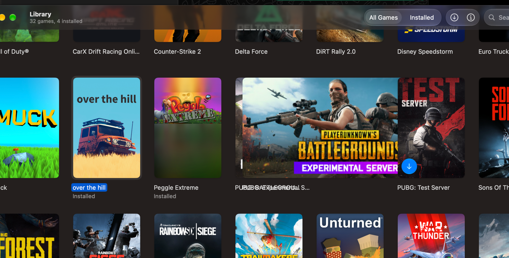
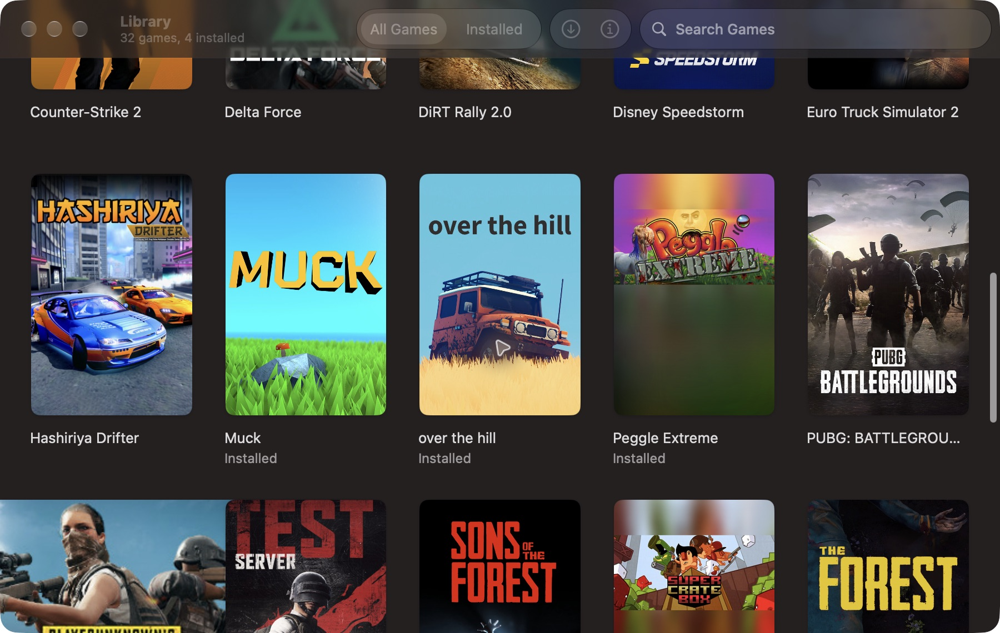
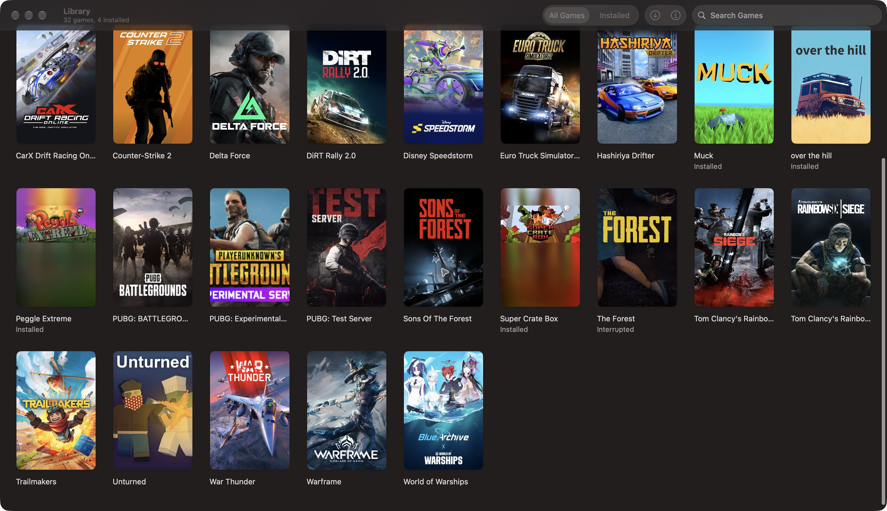

# Library cover bounds verification

Verified on 2026-10-18 using a signed Debug build of `SteamLibrary`, with the unchanged Dev bundle identity and its signed-in library (32 games, 4 installed). Acquired the shared dev slot before app use; quit Dev and confirmed no Dev/dockhost/wineserver processes remained before releasing it. No game install, launch, production-data access, or real Steam-library modification was performed.

## Cause and fix

The old image-driven cover accepted a portrait proposal but reported a wider size for landscape/square artwork. A 460×215 fixture proposed at 140 points wide rendered 449.30 points wide; a square rendered 210 points wide. The rounded clip followed that oversized layout, allowing adjacent art and title frames to overlap. The three PUBG apps have separate identities; the existing merge deduplicates by app ID.

The shared grid/inspector cover now establishes a 2:3 rectangle first, draws aspect-fill artwork in an overlay constrained to that rectangle, and clips to its rounded bounds. The grid's action overlay and selection surround remain outside the artwork layer.

Peggle Extreme's cached source is itself 600×900, including the small banner and blurred background. That presentation comes from the supplied art, not a blur/fallback composited by Pufflet; it is preserved.

## Checks

- Built the original Debug app and reproduced the landscape overflow with computer use.
- Added a renderer regression, observed failure for landscape/square sources, then passed with the fix.
- Final focused test run: 19 tests in SteamArtworkTests and OwnedLibraryTests passed, including three cover aspect ratios, per-app header fallback, duplicate app records and distinct same-name/test-server app IDs.
- Computer-use inspection of the fixed signed-in All Games grid at 900 and 1512 points wide: landscape Experimental Server remains within its portrait card, titles occupy separate cells, and Peggle retains its supplied portrait. Also opened the Test Server inspector without installing.
- An additional coordinate click intended to expose the hover control was rejected by automatic approval review because it could trigger a download. No retry or download was performed. The button overlay order is unchanged; the fixed narrow-grid screenshot observed during inspection showed the control above the Test Server art.
- Full native suite, game launches and downloads were not run for this UI-only change.

## Screenshots

Reported before (PUBG overlap and Peggle):

Original Dev build, Peggle and neighboring cards:

Fixed Dev build, Peggle and all three PUBG apps in the same row:

